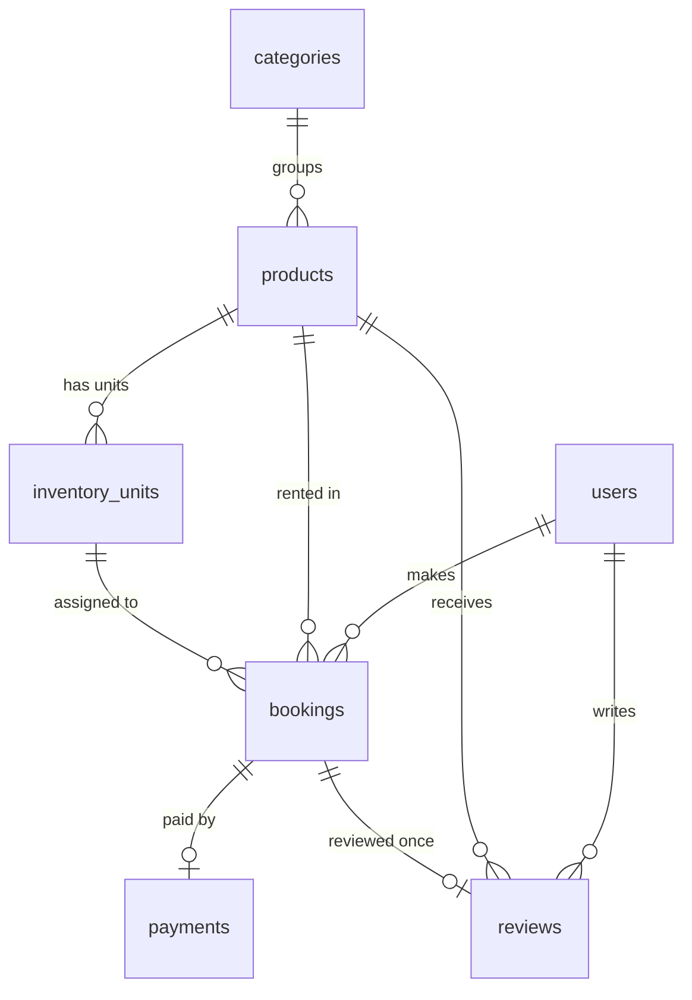

# Rentify

**Rent More. Own Less.**

Rentify is an equipment rental web application: customers browse cameras, consoles, laptops, drones, instruments,
audio gear and projectors, pick dates, see a live price and availability, and book. An administrator prepares the
equipment, hands it over, and records its return. Everything runs on real FastAPI endpoints and PostgreSQL data.

> **Demonstration project.** Payments are simulated, no card details are collected, and nothing is delivered.
> It was built to practise full-stack development and to be read as a learning codebase.

## Problem statement

Buying expensive equipment you will use for a weekend is wasteful. A rental business needs to know, for a given
physical item and a given set of dates, whether it is free, charge a consistent price, and never promise the same
item to two people. Rentify models exactly that: **products** (a camera model), **inventory units** (the three
physical cameras of that model), and **bookings** that reserve one unit for a date range.

## Features

**Customers**
* Register, log in, edit profile
* Search by name or brand, filter by category and price, sort by price or newest, paginate (all in the database)
* Product page with specifications, reviews, date pickers, live availability and total
* Checkout with simulated payment (success or failure), safe against double clicks
* Booking history (upcoming, active, completed, cancelled), cancel before pickup with automatic simulated refund
* Review equipment after returning it; edit or delete your own reviews

**Administrators** (separate `/admin` area)
* Dashboard: live counts, revenue, monthly revenue chart, status chart, most rented equipment
* Manage products (create, edit, change price, upload image, feature, archive), categories (archive, never delete)
  and physical inventory units
* Process pickups and returns (with equipment condition), cancel bookings, see overdue rentals
* View customers and simulated payments

**Rules enforced by the backend**
* Prices are calculated server-side with `Decimal`; booking prices are snapshots
* Availability is calculated from bookings (`existing_pickup < new_return AND existing_return > new_pickup`)
* No double booking: a transaction with a row lock on the product re-checks availability at confirmation
* Idempotency keys make repeated checkout submissions safe
* All permissions are checked on the server; customers can only see their own bookings and reviews

## Technology stack

| Layer | Technology |
|---|---|
| Frontend | React 19, Vite 6, Tailwind CSS 4, React Router, Axios, Lucide icons, Recharts |
| Backend | Python, FastAPI, Uvicorn, Pydantic 2, SQLAlchemy 2 (sync), Alembic, Psycopg 3, PyJWT, Argon2 |
| Database | PostgreSQL 16 |
| Tests | Pytest, FastAPI `TestClient` |
| Containers | Docker Compose runs the database, API and web app together |

## Architecture

```
React (5173)  --JSON + Bearer JWT-->  FastAPI (8000)  --SQLAlchemy-->  PostgreSQL (5432)
 presentation                          routes / schemas / services       data + constraints
```

Details: [docs/ARCHITECTURE.md](docs/ARCHITECTURE.md).

## Database ER diagram



Full diagram with columns, constraints, indexes and example SQL: [docs/DATABASE.md](docs/DATABASE.md).

## Repository structure

```
RENTIFY/
  docker-compose.yml          runs db + api + web (and a separate test database)
  .env.example                secrets for docker compose
  README.md
  docs/
    ARCHITECTURE.md  DATABASE.md  CODEBASE_GUIDE.md
    Rentify - Dev Specs.pdf   the original specification
  backend/
    app/
      main.py config.py database.py dependencies.py
      models/    SQLAlchemy tables
      schemas/   Pydantic request/response models
      routes/    HTTP endpoints
      services/  business logic
      utils/     security, dates, text helpers
    alembic/     migrations
    tests/       pytest suite
    uploads/     uploaded product images (git-ignored)
    seed.py      demo data
    requirements.txt  .env.example  Dockerfile  docker-entrypoint.sh
  frontend/
    src/
      api/ components/ contexts/ hooks/ layouts/ utils/
      pages/customer  pages/auth  pages/admin
    package.json  package-lock.json  vite.config.js  Dockerfile
```

New to the code? Start with [docs/CODEBASE_GUIDE.md](docs/CODEBASE_GUIDE.md).

## Running with Docker (recommended)

**Prerequisite:** Docker with Compose. Nothing else (Python, Node, PostgreSQL) needs to be installed.

```bash
cp .env.example .env        # Windows PowerShell: Copy-Item .env.example .env
# edit .env: set JWT_SECRET (32+ characters) and ADMIN_PASSWORD
docker compose up --build
```

| Service | URL |
|---|---|
| Web app | http://localhost:5173 |
| API | http://localhost:8000 |
| Swagger UI | http://localhost:8000/docs |
| PostgreSQL | localhost:5432 (user `rentify`, password `rentify_dev_password`: development only) |

On start the `api` container applies the Alembic migrations and, because `SEED_DEMO_DATA=true`, loads the demo
data (idempotent, so restarts never duplicate anything). Database rows live in the `rentify_pgdata` volume and
uploaded images in `rentify_uploads`, so both survive restarts and rebuilds.

Settings in `.env` (next to `docker-compose.yml`):

| Variable | Meaning |
|---|---|
| `JWT_SECRET` | random string of at least 32 characters (the API refuses to start otherwise). Generate: `python -c "import secrets; print(secrets.token_urlsafe(48))"` |
| `ADMIN_EMAIL`, `ADMIN_PASSWORD` | the administrator the seed creates. The email must be a valid address (for example `admin@rentify.example.com`; `.local` and `.test` are rejected) |
| `SEED_DEMO_DATA` | `true` loads the demo catalog, customers and bookings on start. With `false` nothing is seeded, and that includes the administrator, so run `docker compose exec api python seed.py` once yourself |

Useful commands:

```bash
docker compose up -d --build      # start in the background (rebuild after code changes)
docker compose logs -f api        # follow the API logs
docker compose down               # stop (data is kept)
docker compose down -v            # stop and DELETE the database and uploaded images
```

The browser calls the API at `http://localhost:8000`. That address is built into the web image
(`VITE_API_BASE_URL` in `docker-compose.yml`), and the API allows only the `http://localhost:5173` origin (CORS).
If you expose the stack on another host, change both and rebuild.

Demo accounts:

| Role | Login | Password |
|---|---|---|
| Admin | the `ADMIN_EMAIL` you set | the `ADMIN_PASSWORD` you set |
| Customer | `priya.sharma@example.com` (also `rahul.verma@`, `ananya.iyer@`, `karthik.nair@` `example.com`) | `Customer@123` |

## Running without containers (development)

Handy when editing code, because the API and Vite reload instantly. **Prerequisites:** Python 3.11+, Node.js 20+,
and PostgreSQL (the Compose database works: `docker compose up -d db`). Commands are for a Unix-style shell; on
Windows PowerShell see the notes in the comments.

### 1. Database

```bash
docker compose up -d db
```

This starts PostgreSQL 16 on port 5432 with databases `rentify` (the app) and `rentify_test` (the tests).
Prefer your own PostgreSQL? Create two databases yourself and put their URLs in `backend/.env`.

### 2. Backend

```bash
cd backend
python -m venv .venv
source .venv/bin/activate            # Windows: .venv\Scripts\Activate.ps1
pip install -r requirements.txt
cp .env.example .env                 # Windows: Copy-Item .env.example .env
```

Edit `backend/.env`: `DATABASE_URL`, `TEST_DATABASE_URL` (its database name **must end in `_test`**), `JWT_SECRET`
(32+ characters), `ADMIN_EMAIL`, `ADMIN_PASSWORD`, and `FRONTEND_ORIGIN` (`http://localhost:5173`). Never commit
`.env`; it is git-ignored.

```bash
alembic upgrade head                 # create the tables
python seed.py                       # demo data; idempotent
uvicorn app.main:app --reload        # http://localhost:8000  (docs at /docs)
```

### 3. Frontend

In a second terminal:

```bash
cd frontend
npm install
npm run dev                          # http://localhost:5173
```

To point at a different API, copy `frontend/.env.example` to `frontend/.env` and change `VITE_API_BASE_URL`.

## API documentation

Interactive documentation is generated by FastAPI at **http://localhost:8000/docs**. All endpoints are under
`/api/v1`. Errors are `{"detail": ...}`.

| Area | Endpoints | Access |
|---|---|---|
| Auth | `POST /auth/register`, `POST /auth/login`, `GET /auth/me` | public / user |
| Profile | `GET`, `PATCH /users/me` | user |
| Categories | `GET /categories`; `POST`, `PATCH /{id}`, `DELETE /{id}` (archives) | public / admin |
| Products | `GET /products`, `/products/featured`, `/products/{id}`; `POST`, `PATCH /{id}`, `DELETE /{id}` (archives) | public / admin |
| Availability | `GET /products/{id}/availability`, `POST /bookings/quote` | public |
| Bookings | `POST /bookings`, `GET /bookings`, `GET /bookings/{id}`, `POST /bookings/{id}/cancel` | owner |
| Reviews | `GET /products/{id}/reviews`; `POST /reviews`, `PATCH`, `DELETE /reviews/{id}` | public / owner |
| Admin bookings | `GET /admin/bookings`, `GET /admin/bookings/{id}`, `POST .../pickup`, `.../return`, `.../cancel` | admin |
| Inventory | `GET`, `POST /admin/inventory`, `PATCH /admin/inventory/{id}` | admin |
| Admin data | `GET /admin/dashboard`, `/admin/users`, `/admin/payments`, `POST /admin/products/{id}/image` | admin |

Status codes: `200`/`201` success, `400` business rule, `401` not authenticated, `402` simulated payment failed,
`403` not allowed, `404` missing, `409` conflict (unavailable, duplicate, price changed), `422` invalid input,
`500` unexpected (details are logged, never returned).

## Running the tests

Start PostgreSQL first (`docker compose up -d db`) and set up `backend/.env` as above, then:

```bash
cd backend
pytest
```

89 tests cover authentication, products and search, inventory rules, image upload, rental dates and pricing,
availability and overlaps, checkout (success, failed payment, price change, idempotency), concurrent booking
attempts, cancellation and refund, pickup/return and invalid transitions, access control, reviews, and the admin
dashboard.

The tests run against `TEST_DATABASE_URL` only. `tests/conftest.py` refuses to start unless its database name
ends in `_test`, and the schema is built from the real Alembic migrations.

Frontend build check:

```bash
cd frontend
npm run build
```

## Known limitations

* **Login is lost on refresh.** For this MVP the JWT lives only in memory (not `localStorage`), so refreshing
  the browser requires logging in again. A production app would use an HttpOnly refresh cookie.
* **Payments are simulated.** There is no gateway, no card data, and refunds are just a status change.
* **One product per booking, no cart.** Each booking reserves a single unit.
* **No taxes, deposits, coupons, delivery or dynamic pricing.**
* **Specification order is not preserved.** Specifications are stored as PostgreSQL `JSONB`, which orders keys
  itself, so they may display in a different order than entered.
* **Admin product/inventory pickers load up to 50 products per request** (they page through all of them).
* **Images are stored on local disk** (`backend/uploads`), served by FastAPI. No CDN or object storage.
* **No email notifications, no password reset, no rate limiting.**
* **The containers are for local use.** The web image serves the built site with Vite's static preview server and the
  compose file uses development passwords, so it is not a production deployment.
* **Python version:** the Docker image uses Python 3.12. Local development was done on 3.11.9; the code uses no
  version-specific features.
* **Not browser-tested on a phone.** The layout is responsive, but the automated browser run used a desktop viewport.

## License

Educational demonstration project.
