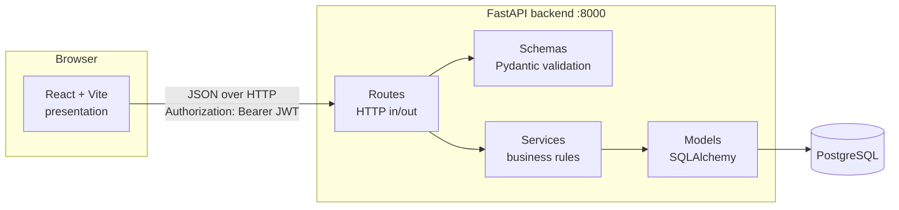
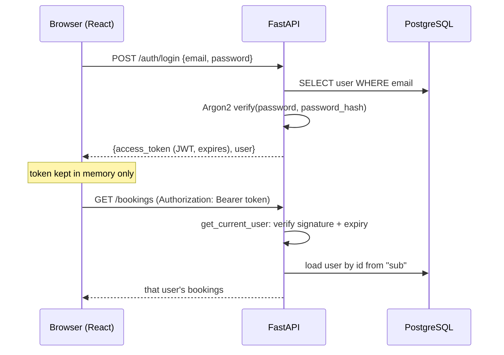
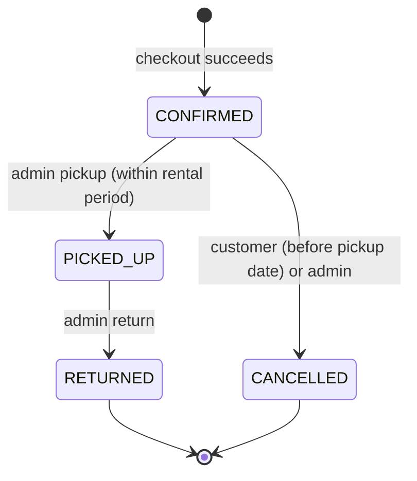

# Architecture

Rentify is a straightforward three-tier application.



| Tier | Technology | Responsibility |
|---|---|---|
| Presentation | React, Tailwind, React Router | pages, forms, calling the API, showing results |
| Application | FastAPI, Pydantic, SQLAlchemy | APIs, authentication, **all business rules** |
| Data | PostgreSQL | persistent data, constraints, transactions |

**The backend is the single source of truth** for prices, availability, booking status and permissions. The
frontend never computes a price or decides who may do something: it displays what the API returns, and hiding a
button is only cosmetic. Every protected endpoint re-checks permissions on the server.

## Frontend and backend communication

* One Axios instance (`frontend/src/api/client.js`) with a configurable base URL (`VITE_API_BASE_URL`, default
  `http://localhost:8000/api/v1`).
* A request interceptor adds `Authorization: Bearer <token>`. A response interceptor treats a `401` that happens
  *while a token is held* as an expired session: it logs out and redirects to the login page.
* `frontend/src/api/index.js` wraps every endpoint in a small function, so pages never build URLs by hand.
* Errors always arrive as `{"detail": ...}`; `utils/format.js: errorMessage` turns any of them into one sentence.
* CORS is enabled only for `FRONTEND_ORIGIN` (`http://localhost:5173`) in `app/main.py`.
* Product images are served by FastAPI `StaticFiles` at `/uploads/...`; the database stores only the relative
  path in `products.image_path`.

## Backend layers

```
backend/app/
  main.py         app factory: CORS, error handlers, routers, /uploads
  config.py       settings from environment (.env)
  database.py     engine, SessionLocal, Base, get_db dependency
  dependencies.py reusable auth dependencies
  routes/         HTTP layer
  schemas/        Pydantic request/response models
  services/       business logic
  models/         SQLAlchemy tables
  utils/          security (JWT, Argon2), dates, text helpers
```

### Routes (`app/routes/`)

Thin: parse the request, call a service, return the result. A route declares its `response_model` and
`status_code`, and its dependencies (`get_current_user`, `require_admin`). Example, `routes/bookings.py`:

```python
@router.post("", response_model=BookingResponse, status_code=201)
def create_booking(data: BookingCreate, response: Response,
                   current_user: User = Depends(get_current_user), db: Session = Depends(get_db)):
    booking, created = booking_service.create_booking(db, current_user, data)
    ...
```

All routes are synchronous `def` functions using a synchronous SQLAlchemy session, which keeps the code easy to
follow. FastAPI runs them in a thread pool.

### Schemas (`app/schemas/`)

Pydantic models do two jobs: **validate incoming data** (email format, password length, date types, rating
1 to 5, non-negative prices) and **shape outgoing data** (so `password_hash` can never leak: `UserResponse`
simply does not have that field). Invalid input is rejected with `422` before any service code runs.

### Services (`app/services/`)

Where the rules live, as plain functions with type hints:

| File | Responsibility |
|---|---|
| `auth_service.py` | register a customer, check credentials |
| `product_service.py` | catalog queries (search, filter, sort, paginate), product CRUD, the product row lock |
| `category_service.py` | category CRUD and archiving |
| `inventory_service.py` | units, "usable" rule, protection against stranding bookings |
| `image_service.py` | validate and store uploaded images |
| `pricing_service.py` | date rules and `Decimal` price calculation |
| `booking_service.py` | availability, checkout transaction, status transitions |
| `review_service.py` | review eligibility |
| `admin_service.py` | dashboard aggregates, customer and payment lists |

Services raise `HTTPException` with the right status code (`400` business rule, `404` missing, `409` conflict),
which keeps error handling in one consistent place. There are deliberately no repository classes or other
extra layers.

### Models (`app/models/`)

One file per table using SQLAlchemy 2.0 `Mapped[...]` typing. They hold relationships and the constraints
(see [DATABASE.md](DATABASE.md)). Alembic builds migrations from these models.

### Error handling

* `HTTPException` → `{"detail": "..."}` with its status code.
* Validation errors → `422` (FastAPI default).
* Any `SQLAlchemyError` or unexpected exception → logged with the stack trace on the server, and the client
  only sees `500 {"detail": "Something went wrong."}`. Raw database errors never reach the browser.
* Logging uses Python's standard `logging`. Passwords and tokens are never logged.

## Authentication flow



* Registration always creates a `CUSTOMER`; the request body cannot choose a role. The first admin is created
  by `seed.py` from `ADMIN_EMAIL` / `ADMIN_PASSWORD`.
* Passwords are hashed with Argon2id (`utils/security.py: hash_password`). The hash holds its own salt.
* The JWT carries `sub` (user id) and `exp`, signed with `JWT_SECRET` (HS256). The decoder pins the algorithm.
* `require_admin` reads the role from the **database row**, not from the token.
* Wrong email and wrong password give the same `401` message, so registered emails are not revealed.
* Customers requesting someone else's booking or review get `404`, not `403`, so ids are not confirmed to exist.
* In React, `AuthContext` holds the user and `api/client.js` holds the token **in memory**. Refreshing the
  browser logs the user out. This is a deliberate MVP simplification (see Known limitations in the README).

## Booking workflow

```mermaid
sequenceDiagram
    participant C as Customer
    participant API as FastAPI
    participant DB as PostgreSQL
    C->>API: GET /products/{id}/availability?pickup&return
    API-->>C: days, daily price, total, available units (nothing reserved)
    C->>API: POST /bookings {dates, expected_total, idempotency_key, payment_outcome}
    API->>DB: BEGIN; lock product row (FOR UPDATE)
    API->>DB: idempotency check, availability re-check
    alt payment_outcome = failure
        API-->>C: 402, nothing created
    else no unit free
        API-->>C: 409 not available
    else total changed since quote
        API-->>C: 409 PRICE_CHANGED + new total
    else
        API->>DB: INSERT booking + payment; COMMIT
        API-->>C: 201 booking (CONFIRMED)
    end
```

Booking status transitions (`booking_service.ALLOWED_TRANSITIONS`; everything else is a `400`):



"Overdue" is not a status. A booking is overdue when it is `PICKED_UP` and its return date has passed; this is
computed in queries and in `booking_service.to_response`. An overdue, unreturned unit is excluded from new
allocations, and confirmed bookings waiting on that unit are flagged for the administrator
(`affected_by_overdue`).

Other rules in the flow:

* **Price**: always recalculated on the server with `Decimal`. The browser sends `expected_total` only so the
  server can detect a changed price and ask the customer to confirm the new one. The daily price and total are
  copied onto the booking, so later price edits never alter history.
* **Idempotency**: the checkout page generates one key per attempt. Repeating the same request returns the
  original booking (`200`); the same key with different dates is rejected (`422`).
* **Cancellation** sets the payment to `REFUNDED` in the same transaction.
* **Simulated payment**: no card data, no gateway. The checkout page lets the user pick success or failure.
