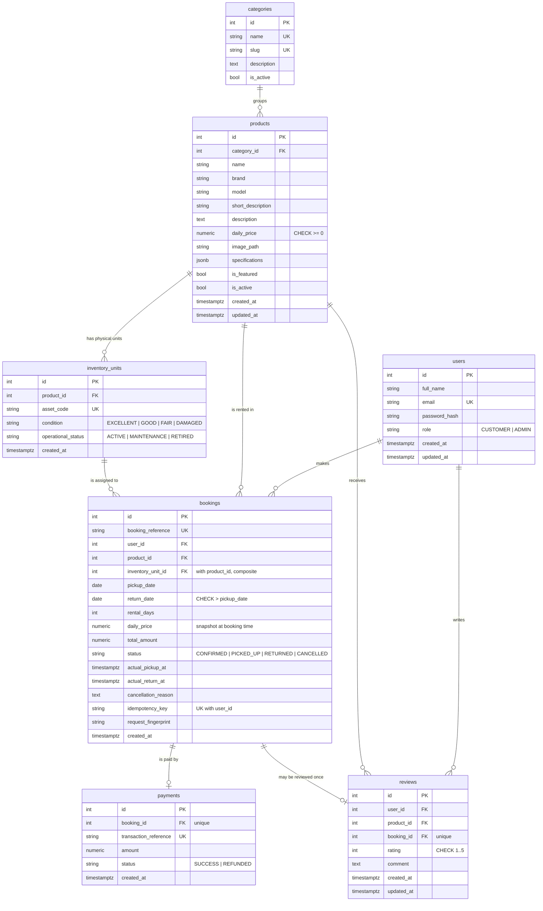

# Database guide

PostgreSQL 16, accessed through SQLAlchemy 2.0 (synchronous). The schema is created only by Alembic
migrations (`backend/alembic/versions/`). Models live in `backend/app/models/`.

## ER diagram



There is no "available" column anywhere. Availability is always **calculated** from `bookings`.

## Keys and relationships

| Table | Primary key | Foreign keys |
|---|---|---|
| `users` | `id` | none |
| `categories` | `id` | none |
| `products` | `id` | `category_id` → `categories.id` |
| `inventory_units` | `id` | `product_id` → `products.id` |
| `bookings` | `id` | `user_id` → `users.id`, `product_id` → `products.id`, and **(`inventory_unit_id`, `product_id`) → `inventory_units(id, product_id)`** |
| `payments` | `id` | `booking_id` → `bookings.id` |
| `reviews` | `id` | `user_id`, `product_id`, `booking_id` |

The composite foreign key on `bookings` is how the database guarantees that **a booking can never point at a
unit belonging to a different product**. It needs the extra unique constraint
`uq_inventory_units_id_product_id (id, product_id)` on `inventory_units` as its target.

## Constraints

| Rule | Constraint |
|---|---|
| Unique email | unique index `ix_users_email` |
| Unique category name and slug | `categories_name_key`, unique index `ix_categories_slug` |
| Unique asset code | `inventory_units_asset_code_key` |
| Unique booking reference | `bookings_booking_reference_key` |
| Unique payment reference | `payments_transaction_reference_key` |
| One payment per booking | `payments_booking_id_key` |
| One review per booking | `reviews_booking_id_key` |
| Same customer + same key = same checkout | `uq_bookings_user_idempotency_key (user_id, idempotency_key)` |
| No negative prices | `ck_products_daily_price_non_negative`, `ck_bookings_amounts_non_negative`, `ck_payments_amount_non_negative` |
| Return after pickup, positive duration | `ck_bookings_return_after_pickup`, `ck_bookings_rental_days_positive` |
| Rating 1 to 5 | `ck_reviews_rating_range` |
| Enum values | `user_role`, `equipment_condition`, `operational_status`, `booking_status`, `payment_status` (CHECK constraints) |

Enums are stored as `VARCHAR` plus a CHECK constraint (SQLAlchemy `native_enum=False`) so adding a value later
is a simple migration rather than `ALTER TYPE`.

## Indexes

Besides the primary keys and unique constraints above:

| Index | Why |
|---|---|
| `ix_bookings_unit_status_dates (inventory_unit_id, status, pickup_date, return_date)` | the availability overlap query |
| `ix_bookings_user_id`, `ix_bookings_product_id`, `ix_bookings_status`, `ix_bookings_inventory_unit_id` | "my bookings", admin filters, joins |
| `ix_products_name`, `ix_products_brand` | search |
| `ix_products_category_id`, `ix_products_is_active` | catalog filters |
| `ix_inventory_units_product_id` | units of a product |
| `ix_reviews_product_id`, `ix_reviews_user_id` | review lists |

## Money, dates and time

* Money is `NUMERIC(10,2)` in the database and `Decimal` in Python. The API sends it as a string (`"2697.00"`)
  so no precision is lost; the frontend only formats it for display.
* `pickup_date` / `return_date` are plain `DATE`s. "Today" is computed in `Asia/Kolkata`
  (`app/utils/dates.py: business_today`).
* Timestamps are `TIMESTAMPTZ`, stored in UTC.

## Date overlap

A booking occupies the half-open range `[pickup_date, return_date)`: the return day is **not** charged and the
unit is free again that day. Two ranges overlap exactly when:

```
existing_pickup_date < requested_return_date  AND  existing_return_date > requested_pickup_date
```

| Existing | Requested | Overlap? |
|---|---|---|
| Dec 1 to Dec 5 | Dec 3 to Dec 7 | yes |
| Dec 1 to Dec 5 | Dec 5 to Dec 8 | no (return day is free) |

Only `CONFIRMED` and `PICKED_UP` bookings block a unit. `CANCELLED` and `RETURNED` never do. A `PICKED_UP`
booking past its return date also blocks the unit regardless of the requested dates, because the equipment
has not come back (the "overdue" rule).

## Transactions and locking

Creating a booking must never allow two customers to get the same unit. `booking_service.create_booking`
does the following in **one transaction**:

1. `SELECT ... FROM products WHERE id = :id FOR UPDATE`: take a row lock on the **product**
   (`product_service.lock_product`). Other checkouts for the same product wait here.
2. Re-check the idempotency key.
3. Re-run the availability query. Because the lock is held, no other checkout can have inserted a
   conflicting booking since.
4. Insert the `bookings` row and its `payments` row.
5. `COMMIT` releases the lock and makes both rows visible together.

Any early exit (failed payment, no unit, price changed) rolls back, which releases the lock and leaves no
partial data. Inventory changes (`inventory_service.create_unit` / `update_unit`) and the condition update on
return take the same product lock, so they cannot interleave with an allocation. Status changes lock the
single booking row (`booking_service._lock_booking`, `FOR UPDATE`) so a cancel and a pickup cannot both win.

Why lock the product and not the unit? A product has only a handful of units, and the lock must also cover
"no unit exists yet that I could pick", so one coarse lock per product is simple and sufficient.

The tests prove this: `tests/test_bookings.py` runs four threads racing for one unit (exactly one succeeds),
and a deterministic test holds the lock while a checkout queues behind it. Removing `FOR UPDATE` makes both
fail.

## Example queries

These run as-is against the seeded database.

Free units of product 1 for a requested period (the same logic as `_available_unit_conditions`):

```sql
SELECT u.id, u.asset_code
FROM inventory_units u
WHERE u.product_id = 1
  AND u.operational_status = 'ACTIVE'
  AND u.condition <> 'DAMAGED'
  AND u.id NOT IN (                      -- not held by an overlapping booking
        SELECT inventory_unit_id FROM bookings
        WHERE status IN ('CONFIRMED', 'PICKED_UP')
          AND pickup_date < DATE '2026-12-08'      -- requested return
          AND return_date > DATE '2026-12-05')     -- requested pickup
  AND u.id NOT IN (                      -- not still out and overdue
        SELECT inventory_unit_id FROM bookings
        WHERE status = 'PICKED_UP' AND return_date < CURRENT_DATE)
ORDER BY u.asset_code;
```

Overdue rentals (computed, never stored):

```sql
SELECT b.booking_reference, p.name, b.return_date
FROM bookings b JOIN products p ON p.id = b.product_id
WHERE b.status = 'PICKED_UP' AND b.return_date < CURRENT_DATE;
```

Revenue by month (successful, non-refunded payments, in business time):

```sql
SELECT to_char(created_at AT TIME ZONE 'Asia/Kolkata', 'YYYY-MM') AS month,
       SUM(amount) AS revenue
FROM payments
WHERE status = 'SUCCESS'
GROUP BY 1 ORDER BY 1;
```

Sanity check: any double-booked unit? (must return zero rows)

```sql
SELECT a.booking_reference, b.booking_reference
FROM bookings a
JOIN bookings b ON a.inventory_unit_id = b.inventory_unit_id AND a.id < b.id
WHERE a.status IN ('CONFIRMED', 'PICKED_UP') AND b.status IN ('CONFIRMED', 'PICKED_UP')
  AND a.pickup_date < b.return_date AND a.return_date > b.pickup_date;
```

Average rating per product:

```sql
SELECT p.name, ROUND(AVG(r.rating), 1) AS avg_rating, COUNT(*) AS reviews
FROM reviews r JOIN products p ON p.id = r.product_id
GROUP BY p.name ORDER BY avg_rating DESC, p.name;
```

Take the booking lock by hand (inside a transaction), to see other checkouts wait:

```sql
BEGIN;
SELECT id FROM products WHERE id = 1 FOR UPDATE;
-- ... other sessions booking product 1 now block until COMMIT or ROLLBACK
ROLLBACK;
```
